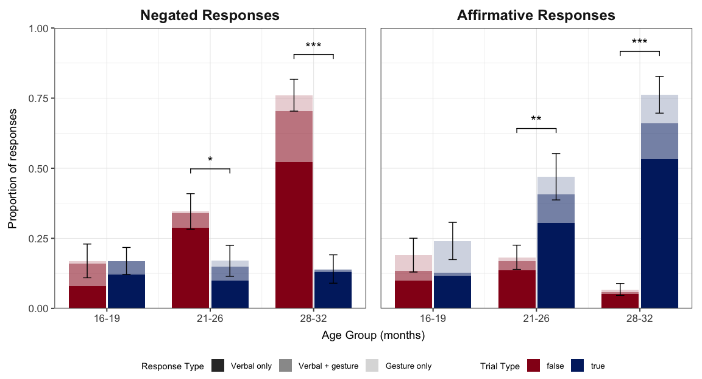
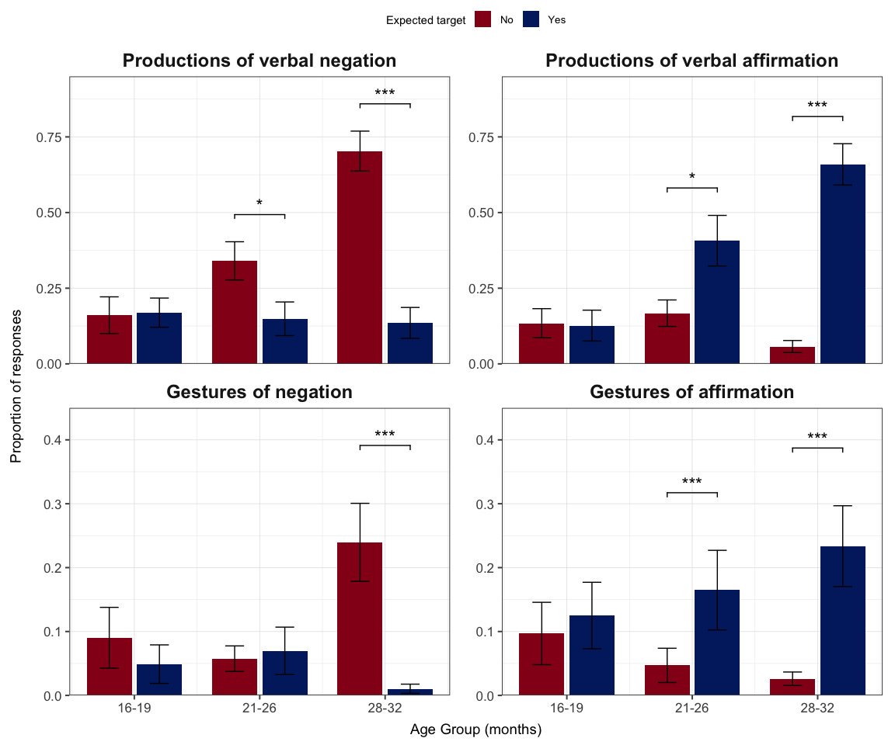
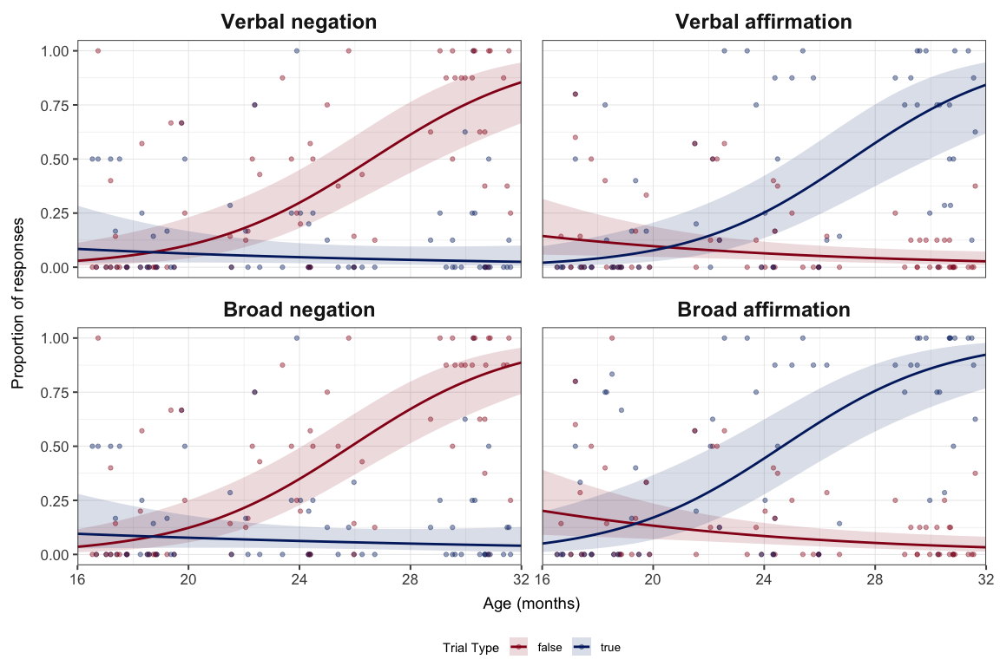
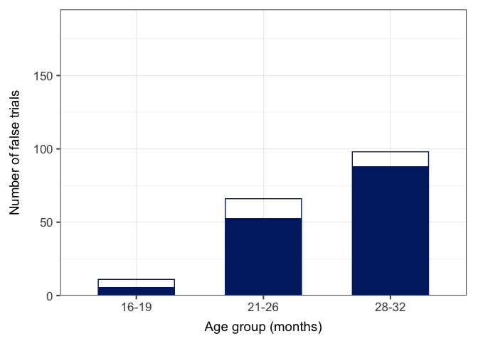
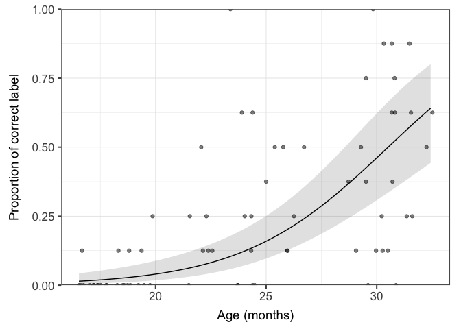
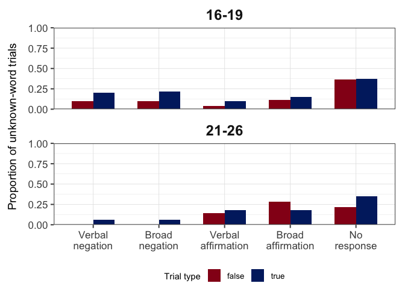

Polar Questions Analyses
================

- [Setup](#setup)
- [Data](#data)
- [Section 1: response ~ target for each age
  group](#section-1-response--target-for-each-age-group)
  - [Youngest age-group](#youngest-age-group)
  - [Middle age-group](#middle-age-group)
  - [Oldest age-group](#oldest-age-group)
  - [Figure: broad responses by age
    group](#figure-broad-responses-by-age-group)
- [Section 2: Nonverbal responses
  (exploratory)](#section-2-nonverbal-responses-exploratory)
  - [Figure: verbal responses and gestures
    (BUCLD)](#figure-verbal-responses-and-gestures-bucld)
- [Section 3: response ~ target \*
  age](#section-3-response--target--age)
  - [Fitting models](#fitting-models)
  - [Figure with age being
    continuous](#figure-with-age-being-continuous)
- [Section 4: Secondary and exploratory
  analyses](#section-4-secondary-and-exploratory-analyses)
  - [Parental bias](#parental-bias)
  - [Labeling for false trials](#labeling-for-false-trials)
  - [Vocabulary](#vocabulary)
- [Inter-coder reliability](#inter-coder-reliability)

## Setup

Load in relevant libraries and set up some default settings.

``` r
## set working directory to current folder
setwd(dirname(rstudioapi::getActiveDocumentContext()$`path`))

## set rmd settings 
knitr::opts_chunk$set(message = FALSE, warning = FALSE, fig.path = "other-figures/")

## load libraries
library(dplyr)
library(ggplot2)
library(tidyr)
library(lme4)
library(emmeans)

## set plotting preferences
ggplot2::theme_set(theme_bw(base_size = 16))
ggplot2::theme_update(
  panel.grid = element_line(colour = "grey90", linewidth = 0.3),
  panel.border = element_rect(colour = "grey30", fill = NA, linewidth = 0.7),
  panel.spacing = grid::unit(18, "pt"),
  axis.ticks = element_line(colour = "grey30", linewidth = 0.7, lineend = "butt"),
  axis.title = element_text(size = 14),
  axis.title.x = element_text(margin = margin(t = 8)),
  axis.title.y = element_text(margin = margin(r = 12)),
  strip.background = element_blank(),
  strip.text = element_text(size = 18, face = "bold", margin = margin(b = 8)),
  plot.margin = margin(10, 12, 8, 10),
  legend.key = element_blank(),
  legend.position = "bottom",
  legend.spacing.x = grid::unit(60, "pt"), legend.box.spacing = grid::unit(22, "pt"),
  legend.margin = margin(0, 0, 0, 0), legend.box.margin = margin(0, 0, 0, 0),
  legend.text = element_text(size = 10), legend.title = element_text(size = 11)
)
options(ggplot2.discrete.colour = c("#95001a", "#01256e")) # alternative: "#f2c100"
options(ggplot2.discrete.fill = getOption("ggplot2.discrete.colour"))
```

## Data

Read in dataset, add new variables, and apply exclusion criteria.

``` r
## read in data
mainD <- read.csv("initialD.csv")
dim(mainD)
```

    ## [1] 1344   29

``` r
str(mainD)
```

    ## 'data.frame':    1344 obs. of  29 variables:
    ##  $ participant_id        : chr  "S01" "S01" "S01" "S01" ...
    ##  $ age_months            : num  24.4 24.4 24.4 24.4 24.4 ...
    ##  $ order                 : int  1 1 1 1 1 1 1 1 1 1 ...
    ##  $ book                  : chr  "busy-babies" "busy-babies" "busy-babies" "busy-babies" ...
    ##  $ question              : chr  "a cat?" "a horse?" "a bird?" "a pig?" ...
    ##  $ target                : chr  "No" "Yes" "Yes" "No" ...
    ##  $ child_q1              : chr  "Yes" "Yes" "Yes" "Yes" ...
    ##  $ child_q1_transcription: chr  "\"no\" \"bunny\"" "\"yah\"" "\"yah\"" "*shakes head* \"no doggy\"" ...
    ##  $ child_q2              : chr  "Verbal response" "Verbal response" "Verbal response" "Both verbal and non-verbal responses" ...
    ##  $ child_q3              : chr  "" "" "" "Same time" ...
    ##  $ child_q4              : chr  "No" "Yes" "Yes" "No" ...
    ##  $ child_q4_dropdown     : chr  "" "yah" "yah" "" ...
    ##  $ child_q5              : chr  "Yes" "No" "No" "Yes" ...
    ##  $ child_q5_dropdown     : chr  "no" "" "" "no" ...
    ##  $ child_q6              : chr  "" "" "" "No" ...
    ##  $ child_q6_dropdown     : chr  "" "" "" "" ...
    ##  $ child_q7              : chr  "" "" "" "Yes" ...
    ##  $ child_q7_dropdown     : chr  "" "" "" "Shook head" ...
    ##  $ child_q8              : chr  "No" "No" "No" "No" ...
    ##  $ child_q8_dropdown     : chr  "\"bunny\"" "" "" "" ...
    ##  $ parent_p1             : chr  "Neither, could go either way" "Neither, could go either way" "Neither, could go either way" "Neither, could go either way" ...
    ##  $ look                  : chr  "Yes" "Yes" "Yes" "Yes" ...
    ##  $ action                : chr  "No" "No" "No" "No" ...
    ##  $ comment               : chr  "" "" "" "throughout he is touching / playing with his shoe/sock but doesnt look directly at it, the attention is directe"| __truncated__ ...
    ##  $ exclude_cdi           : int  0 0 0 0 0 0 0 0 0 0 ...
    ##  $ exclude_base          : int  0 0 0 0 0 0 0 0 0 0 ...
    ##  $ exclude_trial         : int  0 0 0 0 0 0 0 0 0 0 ...
    ##  $ book_item             : chr  "bunny" "horse" "bird" "dog" ...
    ##  $ label_correct         : int  1 NA NA NA NA NA 1 1 1 0 ...

``` r
## reformat
mainD$target <- factor(mainD$target, levels = c("No", "Yes"), labels = c("false", "true"))
mainD$participant_id <- factor(mainD$participant_id)
mainD$question <- factor(mainD$question)
mainD$parent_p1 <- factor(mainD$parent_p1, labels = c("neither", "true", "false"),
  levels = c("Neither, could go either way", "A true trial", "A false trial"))

## add age-group variable
mainD$ageBin <- factor(ifelse(mainD$age_months < 20, "16-19", ifelse(mainD$age_months > 27, "28-32", "21-26")), levels = c("16-19", "21-26", "28-32"))
aggregate(participant_id ~ ageBin, data = mainD, FUN = function(x) length(unique(x))) #count by age group
```

    ##   ageBin participant_id
    ## 1  16-19             34
    ## 2  21-26             25
    ## 3  28-32             25

``` r
## add response variables
mainD$no <- ifelse(mainD$child_q5=="Yes", 1, 0) #verbally say a variation of "no"?
mainD$yes <- ifelse(mainD$child_q4=="Yes", 1, 0) #verbally say a variation of "yes"?
mainD$noGest <- ifelse(mainD$child_q7=="Yes", 1, 0) #give other nonverbal indicator of negation?
mainD$yesGest <- ifelse(mainD$child_q6_dropdown=="Nod", 1, 0) #dropdown menu of nonverbal indicator of affirmation
mainD$deny <- ifelse(mainD$no == 1 | (mainD$noGest == 1 & mainD$yes == 0), 1, 0) #broad negation
mainD$affirm <- ifelse(mainD$yes == 1 | (mainD$yesGest == 1 & mainD$no == 0), 1, 0) #broad affirmation

## add accuracy variables
mainD$correctWord <- ifelse(mainD$no & mainD$target=="false", 1, ifelse(mainD$yes & mainD$target=="true", 1, 0)) 
mainD$correctBroad <- ifelse(mainD$deny & mainD$target=="false", 1, ifelse(mainD$affirm & mainD$target=="true", 1, 0))

## add other variables
mainD$parent_bias <- ifelse((mainD$parent_p1 == "true" & mainD$target == "true") | (mainD$parent_p1 == "false" & mainD$target == "false"), 1, 0)
mainD$neg_restyp <- factor(ifelse(mainD$deny == 0, "None", ifelse(mainD$no == 0, "Gesture only", ifelse(mainD$noGest == 0, "Verbal only", "Verbal + gesture"))), levels = c("Verbal only", "Verbal + gesture", "Gesture only", "None")) #for plotting
mainD$aff_restyp <- factor(ifelse(mainD$affirm == 0, "None", ifelse(mainD$yes == 0, "Gesture only", ifelse(mainD$yesGest == 0, "Verbal only", "Verbal + gesture"))), levels = c("Verbal only", "Verbal + gesture", "Gesture only", "None")) #for plotting

## exclude participants when parents do not ask questions for >=4 trials (blank child_q1), S40 excluded
mainD <- mainD %>% filter(sum(child_q1 == "") < 4, .by = participant_id)

## exclude inattentive participants >=4 trials, S41 S74 S75 excluded
mainD <- mainD %>% filter(sum(look == "No", na.rm = TRUE) < 4, .by = participant_id)

## select first 6 participants in each age-group/order
mainD <- mainD %>%
  filter(participant_id %in% head(unique(participant_id), 6), .by = c(ageBin, order))
mainD %>% distinct(participant_id, ageBin, order) %>% with(table(ageBin, order)) 
```

    ##        order
    ## ageBin  1 2 3 4
    ##   16-19 6 6 6 6
    ##   21-26 6 6 6 6
    ##   28-32 6 6 6 6

``` r
## mean age
aggregate(age_months ~ ageBin, distinct(mainD, participant_id, ageBin, age_months), mean)
```

    ##   ageBin age_months
    ## 1  16-19   18.06721
    ## 2  21-26   24.00992
    ## 3  28-32   30.50671

``` r
## cleaned dataset for analyses
finalD <- mainD %>%
  filter(!exclude_trial %in% 1) %>% #exclude no-response and unknown word trials
  select(participant_id, age_months, order, book, question, target, ageBin,
         exclude_cdi, parent_p1, parent_bias, no, yes, noGest, yesGest, deny, affirm, 
         child_q4_dropdown, child_q5_dropdown, child_q6_dropdown, child_q7_dropdown, 
         neg_restyp, aff_restyp)
finalD$age_c <- finalD$age_months - mean(finalD$age_months) #center age

## view dataset
aggregate(cbind(Total = 1, no, yes, deny, affirm) ~ ageBin, finalD, sum) #resp for each age group
```

    ##   ageBin Total  no yes deny affirm
    ## 1  16-19   206  40  28   41     49
    ## 2  21-26   314  82  93   85    105
    ## 3  28-32   382 161 137  173    158

``` r
table(finalD$target, finalD$child_q5_dropdown) %>% {.[, order(colSums(.), decreasing = TRUE)]} #types of verbal negated responses
```

    ##        
    ##              no nah Nope nuh nope not nuh uh
    ##   false 240 196  13    2   1    0   1      1
    ##   true  379  58   9    0   1    1   0      0

``` r
table(finalD$target, finalD$child_q4_dropdown) %>% {.[, order(colSums(.), decreasing = TRUE)]} #types of verbal aff responses
```

    ##        
    ##             yah yes yeah yeh yuh uh huh it is mhm
    ##   false 404  21  12    8   3   4      2     0   0
    ##   true  240 111  41   44   3   2      3     2   2

``` r
table(finalD$target, finalD$child_q7_dropdown) %>% {.[, order(colSums(.), decreasing = TRUE)]} #types of nonverbal negated responses
```

    ##        
    ##             Shook head turned head
    ##   false 387         66           1
    ##   true  433         15           0

``` r
table(finalD$target, finalD$child_q6_dropdown) %>% {.[, order(colSums(.), decreasing = TRUE)]} #types of nonverbal aff responses
```

    ##        
    ##             Nod pointing
    ##   false 403  23       28
    ##   true  333  87       28

``` r
head(finalD)
```

    ##   participant_id age_months order        book question target ageBin
    ## 1            S01     24.387     1 busy-babies   a cat?  false  21-26
    ## 2            S01     24.387     1 busy-babies a horse?   true  21-26
    ## 3            S01     24.387     1 busy-babies  a bird?   true  21-26
    ## 4            S01     24.387     1 busy-babies   a pig?  false  21-26
    ## 5            S01     24.387     1 busy-babies  a bear?   true  21-26
    ## 6            S01     24.387     1 busy-babies   a cow?   true  21-26
    ##   exclude_cdi parent_p1 parent_bias no yes noGest yesGest deny affirm
    ## 1           0   neither           0  1   0      0       0    1      0
    ## 2           0   neither           0  0   1      0       0    0      1
    ## 3           0   neither           0  0   1      0       0    0      1
    ## 4           0   neither           0  1   0      1       0    1      0
    ## 5           0   neither           0  0   1      0       0    0      1
    ## 6           0   neither           0  0   1      0       0    0      1
    ##   child_q4_dropdown child_q5_dropdown child_q6_dropdown child_q7_dropdown
    ## 1                                  no                                    
    ## 2               yah                                                      
    ## 3               yah                                                      
    ## 4                                  no                          Shook head
    ## 5               yah                                                      
    ## 6               yah                                                      
    ##         neg_restyp  aff_restyp     age_c
    ## 1      Verbal only        None -1.098686
    ## 2             None Verbal only -1.098686
    ## 3             None Verbal only -1.098686
    ## 4 Verbal + gesture        None -1.098686
    ## 5             None Verbal only -1.098686
    ## 6             None Verbal only -1.098686

``` r
## export dataset
write.csv(finalD, "finalD.csv", row.names = FALSE)
```

## Section 1: response ~ target for each age group

response ~ target + (1 + target \| participant_id) + (1 + target \|
question) <br> response ~ target + (1 + target \| participant_id) + (1
\| question) <br> response ~ target + (1 \| participant_id) + (1 \|
question) <br> response ~ target + (1 \| participant_id) + question <br>
wilcoxon

### Youngest age-group

``` r
youngData <- finalD[finalD$ageBin == "16-19",]

### DV1: verbal negation "no"
young_vneg <- glmer(no ~ target + (1 | participant_id) + (1 | question), data = youngData, family = binomial(link = "logit")) #failed to converge; singular; ok
summary(young_vneg)
```

    ## Generalized linear mixed model fit by maximum likelihood (Laplace
    ##   Approximation) [glmerMod]
    ##  Family: binomial  ( logit )
    ## Formula: no ~ target + (1 | participant_id) + (1 | question)
    ##    Data: youngData
    ## 
    ##      AIC      BIC   logLik deviance df.resid 
    ##    180.6    193.9    -86.3    172.6      202 
    ## 
    ## Scaled residuals: 
    ##     Min      1Q  Median      3Q     Max 
    ## -1.5369 -0.3910 -0.1825 -0.1588  3.6064 
    ## 
    ## Random effects:
    ##  Groups         Name        Variance Std.Dev.
    ##  participant_id (Intercept) 3.65960  1.9130  
    ##  question       (Intercept) 0.01855  0.1362  
    ## Number of obs: 206, groups:  participant_id, 23; question, 16
    ## 
    ## Fixed effects:
    ##             Estimate Std. Error z value Pr(>|z|)    
    ## (Intercept)  -2.3929     0.6824  -3.506 0.000454 ***
    ## targettrue   -0.1213     0.4248  -0.286 0.775251    
    ## ---
    ## Signif. codes:  0 '***' 0.001 '**' 0.01 '*' 0.05 '.' 0.1 ' ' 1
    ## 
    ## Correlation of Fixed Effects:
    ##            (Intr)
    ## targettrue -0.314

``` r
### DV2: verbal affirmation "yes"
young_vaff <- glmer(yes ~ target + (1 | participant_id) + question, data = youngData, family = binomial(link = "logit"), control = glmerControl(optimizer = "bobyqa")) #singular; does not converge; ok, switch optimizer, no vaff for pig
summary(young_vaff)
```

    ## Generalized linear mixed model fit by maximum likelihood (Laplace
    ##   Approximation) [glmerMod]
    ##  Family: binomial  ( logit )
    ## Formula: yes ~ target + (1 | participant_id) + question
    ##    Data: youngData
    ## Control: glmerControl(optimizer = "bobyqa")
    ## 
    ##      AIC      BIC   logLik deviance df.resid 
    ##    160.3    220.2    -62.1    124.3      188 
    ## 
    ## Scaled residuals: 
    ##     Min      1Q  Median      3Q     Max 
    ## -1.4415 -0.2635 -0.1529 -0.0799  5.7653 
    ## 
    ## Random effects:
    ##  Groups         Name        Variance Std.Dev.
    ##  participant_id (Intercept) 4.562    2.136   
    ## Number of obs: 206, groups:  participant_id, 23
    ## 
    ## Fixed effects:
    ##                        Estimate Std. Error z value Pr(>|z|)  
    ## (Intercept)            -2.43218    1.06375  -2.286   0.0222 *
    ## targettrue             -0.08649    0.54548  -0.159   0.8740  
    ## questiona bear?        -0.16398    1.41317  -0.116   0.9076  
    ## questiona bird?        -0.47246    1.10920  -0.426   0.6701  
    ## questiona block?       -0.06935    1.36880  -0.051   0.9596  
    ## questiona bottle?      -0.41553    1.11632  -0.372   0.7097  
    ## questiona bunny?       -1.50049    1.42832  -1.051   0.2935  
    ## questiona car?         -1.61360    1.50713  -1.071   0.2843  
    ## questiona cat?         -0.91197    1.20213  -0.759   0.4481  
    ## questiona cookie?      -1.65040    1.55708  -1.060   0.2892  
    ## questiona cow?         -1.14523    1.39895  -0.819   0.4130  
    ## questiona cup?          0.47380    1.09970   0.431   0.6666  
    ## questiona dog?         -0.44380    1.21546  -0.365   0.7150  
    ## questiona horse?        0.19092    1.31612   0.145   0.8847  
    ## questiona pig?        -17.67135  341.33368  -0.052   0.9587  
    ## questiona teddy bear?  -1.12295    1.53480  -0.732   0.4644  
    ## questionan apple?      -2.00722    1.46063  -1.374   0.1694  
    ## ---
    ## Signif. codes:  0 '***' 0.001 '**' 0.01 '*' 0.05 '.' 0.1 ' ' 1

``` r
### DV3: broad negation "deny"
young_bneg <- glmer(deny ~ target + (1 + target | participant_id) + (1 | question), data = youngData, family = binomial(link = "logit")) #failed to converge; ok 
summary(young_bneg)
```

    ## Generalized linear mixed model fit by maximum likelihood (Laplace
    ##   Approximation) [glmerMod]
    ##  Family: binomial  ( logit )
    ## Formula: deny ~ target + (1 + target | participant_id) + (1 | question)
    ##    Data: youngData
    ## 
    ##      AIC      BIC   logLik deviance df.resid 
    ##    187.7    207.7    -87.9    175.7      200 
    ## 
    ## Scaled residuals: 
    ##     Min      1Q  Median      3Q     Max 
    ## -1.4061 -0.3735 -0.2412 -0.1089  2.9577 
    ## 
    ## Random effects:
    ##  Groups         Name        Variance Std.Dev. Corr 
    ##  participant_id (Intercept) 6.87637  2.6223        
    ##                 targettrue  2.40883  1.5520   -0.94
    ##  question       (Intercept) 0.02508  0.1584        
    ## Number of obs: 206, groups:  participant_id, 23; question, 16
    ## 
    ## Fixed effects:
    ##             Estimate Std. Error z value Pr(>|z|)   
    ## (Intercept)  -2.9264     1.0778  -2.715  0.00662 **
    ## targettrue    0.8643     1.0520   0.822  0.41129   
    ## ---
    ## Signif. codes:  0 '***' 0.001 '**' 0.01 '*' 0.05 '.' 0.1 ' ' 1
    ## 
    ## Correlation of Fixed Effects:
    ##            (Intr)
    ## targettrue -0.869

``` r
### DV4: broad affirmation "affirm"
young_baff <- glmer(affirm ~ target + (1 | participant_id) + question, data = youngData, family = binomial(link = "logit"), control = glmerControl(optimizer = "bobyqa", optCtrl = list(maxfun = 200000))) #failed to converge; singular; singular; failed to converge; ok, switch optimizer, similar with nlminbwrap
summary(young_baff)
```

    ## Generalized linear mixed model fit by maximum likelihood (Laplace
    ##   Approximation) [glmerMod]
    ##  Family: binomial  ( logit )
    ## Formula: affirm ~ target + (1 | participant_id) + question
    ##    Data: youngData
    ## Control: glmerControl(optimizer = "bobyqa", optCtrl = list(maxfun = 2e+05))
    ## 
    ##      AIC      BIC   logLik deviance df.resid 
    ##    207.5    267.4    -85.8    171.5      188 
    ## 
    ## Scaled residuals: 
    ##     Min      1Q  Median      3Q     Max 
    ## -1.6410 -0.3364 -0.1610 -0.0704  4.0571 
    ## 
    ## Random effects:
    ##  Groups         Name        Variance Std.Dev.
    ##  participant_id (Intercept) 5.246    2.29    
    ## Number of obs: 206, groups:  participant_id, 23
    ## 
    ## Fixed effects:
    ##                       Estimate Std. Error z value Pr(>|z|)  
    ## (Intercept)            -1.7288     0.9414  -1.836   0.0663 .
    ## targettrue              0.7189     0.4541   1.583   0.1134  
    ## questiona bear?        -0.2664     1.1919  -0.223   0.8232  
    ## questiona bird?        -0.7597     0.9950  -0.763   0.4452  
    ## questiona block?       -1.1207     1.1688  -0.959   0.3376  
    ## questiona bottle?      -0.5188     0.9756  -0.532   0.5948  
    ## questiona bunny?       -1.1312     1.1057  -1.023   0.3063  
    ## questiona car?         -0.4366     1.0400  -0.420   0.6747  
    ## questiona cat?         -1.7177     1.0564  -1.626   0.1040  
    ## questiona cookie?      -1.4868     1.1818  -1.258   0.2084  
    ## questiona cow?         -0.9389     1.0881  -0.863   0.3882  
    ## questiona cup?         -0.4548     1.0233  -0.444   0.6567  
    ## questiona dog?         -2.1653     1.2403  -1.746   0.0809 .
    ## questiona horse?       -0.9632     1.2206  -0.789   0.4301  
    ## questiona pig?         -2.6482     1.5812  -1.675   0.0940 .
    ## questiona teddy bear?  -1.1941     1.2972  -0.920   0.3573  
    ## questionan apple?      -0.9824     1.0454  -0.940   0.3473  
    ## ---
    ## Signif. codes:  0 '***' 0.001 '**' 0.01 '*' 0.05 '.' 0.1 ' ' 1

### Middle age-group

``` r
middleData <- finalD[finalD$ageBin == "21-26",]

### DV1: verbal negation "no"
middle_vneg <- glmer(no ~ target + (1 + target | participant_id) + (1 | question), data = middleData, family = binomial(link = "logit")) #failed to converge; ok
summary(middle_vneg)
```

    ## Generalized linear mixed model fit by maximum likelihood (Laplace
    ##   Approximation) [glmerMod]
    ##  Family: binomial  ( logit )
    ## Formula: no ~ target + (1 + target | participant_id) + (1 | question)
    ##    Data: middleData
    ## 
    ##      AIC      BIC   logLik deviance df.resid 
    ##    300.0    322.5   -144.0    288.0      308 
    ## 
    ## Scaled residuals: 
    ##     Min      1Q  Median      3Q     Max 
    ## -1.7423 -0.4631 -0.1419  0.3381  2.8692 
    ## 
    ## Random effects:
    ##  Groups         Name        Variance Std.Dev. Corr 
    ##  participant_id (Intercept) 2.27620  1.5087        
    ##                 targettrue  8.08667  2.8437   -0.43
    ##  question       (Intercept) 0.01269  0.1127        
    ## Number of obs: 314, groups:  participant_id, 23; question, 16
    ## 
    ## Fixed effects:
    ##             Estimate Std. Error z value Pr(>|z|)  
    ## (Intercept)  -0.9287     0.3957  -2.347   0.0189 *
    ## targettrue   -2.3329     1.0467  -2.229   0.0258 *
    ## ---
    ## Signif. codes:  0 '***' 0.001 '**' 0.01 '*' 0.05 '.' 0.1 ' ' 1
    ## 
    ## Correlation of Fixed Effects:
    ##            (Intr)
    ## targettrue -0.326

``` r
### DV2: verbal affirmation "yes"
middle_vaff <- glmer(yes ~ target + (1 + target | participant_id) + (1 | question), data = middleData, family = binomial(link = "logit")) #singular; ok
summary(middle_vaff)
```

    ## Generalized linear mixed model fit by maximum likelihood (Laplace
    ##   Approximation) [glmerMod]
    ##  Family: binomial  ( logit )
    ## Formula: yes ~ target + (1 + target | participant_id) + (1 | question)
    ##    Data: middleData
    ## 
    ##      AIC      BIC   logLik deviance df.resid 
    ##    294.0    316.5   -141.0    282.0      308 
    ## 
    ## Scaled residuals: 
    ##     Min      1Q  Median      3Q     Max 
    ## -2.3286 -0.3824 -0.2401  0.2731  3.0941 
    ## 
    ## Random effects:
    ##  Groups         Name        Variance Std.Dev. Corr 
    ##  participant_id (Intercept) 1.73733  1.3181        
    ##                 targettrue  6.28281  2.5066   -0.20
    ##  question       (Intercept) 0.06846  0.2617        
    ## Number of obs: 314, groups:  participant_id, 23; question, 16
    ## 
    ## Fixed effects:
    ##             Estimate Std. Error z value Pr(>|z|)    
    ## (Intercept)  -2.2493     0.4713  -4.772 1.82e-06 ***
    ## targettrue    1.5903     0.7303   2.178   0.0294 *  
    ## ---
    ## Signif. codes:  0 '***' 0.001 '**' 0.01 '*' 0.05 '.' 0.1 ' ' 1
    ## 
    ## Correlation of Fixed Effects:
    ##            (Intr)
    ## targettrue -0.492

``` r
### DV3: broad negation "deny"
middle_bneg <- glmer(deny ~ target + (1 + target | participant_id) + (1 | question), data = middleData, family = binomial(link = "logit")) #singular; ok
summary(middle_bneg)
```

    ## Generalized linear mixed model fit by maximum likelihood (Laplace
    ##   Approximation) [glmerMod]
    ##  Family: binomial  ( logit )
    ## Formula: deny ~ target + (1 + target | participant_id) + (1 | question)
    ##    Data: middleData
    ## 
    ##      AIC      BIC   logLik deviance df.resid 
    ##    312.1    334.6   -150.1    300.1      308 
    ## 
    ## Scaled residuals: 
    ##     Min      1Q  Median      3Q     Max 
    ## -1.6157 -0.4635 -0.1993  0.3968  2.8685 
    ## 
    ## Random effects:
    ##  Groups         Name        Variance Std.Dev. Corr 
    ##  participant_id (Intercept) 2.372    1.5402        
    ##                 targettrue  5.823    2.4130   -0.53
    ##  question       (Intercept) 0.102    0.3193        
    ## Number of obs: 314, groups:  participant_id, 23; question, 16
    ## 
    ## Fixed effects:
    ##             Estimate Std. Error z value Pr(>|z|)  
    ## (Intercept)  -0.9064     0.4090  -2.216   0.0267 *
    ## targettrue   -1.7078     0.7683  -2.223   0.0262 *
    ## ---
    ## Signif. codes:  0 '***' 0.001 '**' 0.01 '*' 0.05 '.' 0.1 ' ' 1
    ## 
    ## Correlation of Fixed Effects:
    ##            (Intr)
    ## targettrue -0.450

``` r
### DV4: broad affirmation "affirm"
middle_baff <- glmer(affirm ~ target + (1 + target | participant_id) + (1 + target | question), data = middleData, family = binomial(link = "logit"))
summary(middle_baff)
```

    ## Generalized linear mixed model fit by maximum likelihood (Laplace
    ##   Approximation) [glmerMod]
    ##  Family: binomial  ( logit )
    ## Formula: affirm ~ target + (1 + target | participant_id) + (1 + target |  
    ##     question)
    ##    Data: middleData
    ## 
    ##      AIC      BIC   logLik deviance df.resid 
    ##    312.8    342.8   -148.4    296.8      306 
    ## 
    ## Scaled residuals: 
    ##     Min      1Q  Median      3Q     Max 
    ## -2.3526 -0.4122 -0.2558  0.4261  2.5945 
    ## 
    ## Random effects:
    ##  Groups         Name        Variance Std.Dev. Corr 
    ##  participant_id (Intercept) 1.6996   1.3037        
    ##                 targettrue  4.6608   2.1589   -0.15
    ##  question       (Intercept) 0.3691   0.6075        
    ##                 targettrue  0.3192   0.5650   -1.00
    ## Number of obs: 314, groups:  participant_id, 23; question, 16
    ## 
    ## Fixed effects:
    ##             Estimate Std. Error z value Pr(>|z|)    
    ## (Intercept)  -2.1857     0.5054  -4.325 1.53e-05 ***
    ## targettrue    2.0013     0.6848   2.922  0.00347 ** 
    ## ---
    ## Signif. codes:  0 '***' 0.001 '**' 0.01 '*' 0.05 '.' 0.1 ' ' 1
    ## 
    ## Correlation of Fixed Effects:
    ##            (Intr)
    ## targettrue -0.570

### Oldest age-group

``` r
oldData <- finalD[finalD$ageBin == "28-32",]

### DV1: verbal negation "no"
old_vneg <- glmer(no ~ target + (1 + target | participant_id) + (1 | question), data = oldData, family = binomial(link = "logit")) #singular; ok
summary(old_vneg)
```

    ## Generalized linear mixed model fit by maximum likelihood (Laplace
    ##   Approximation) [glmerMod]
    ##  Family: binomial  ( logit )
    ## Formula: no ~ target + (1 + target | participant_id) + (1 | question)
    ##    Data: oldData
    ## 
    ##      AIC      BIC   logLik deviance df.resid 
    ##    298.6    322.3   -143.3    286.6      376 
    ## 
    ## Scaled residuals: 
    ##     Min      1Q  Median      3Q     Max 
    ## -5.8873 -0.2524 -0.0389  0.2742  5.1377 
    ## 
    ## Random effects:
    ##  Groups         Name        Variance Std.Dev. Corr
    ##  participant_id (Intercept) 5.0329   2.243        
    ##                 targettrue  2.0911   1.446    0.49
    ##  question       (Intercept) 0.2788   0.528        
    ## Number of obs: 382, groups:  participant_id, 24; question, 16
    ## 
    ## Fixed effects:
    ##             Estimate Std. Error z value Pr(>|z|)    
    ## (Intercept)   1.5032     0.5627   2.671  0.00755 ** 
    ## targettrue   -5.4605     0.9366  -5.830 5.55e-09 ***
    ## ---
    ## Signif. codes:  0 '***' 0.001 '**' 0.01 '*' 0.05 '.' 0.1 ' ' 1
    ## 
    ## Correlation of Fixed Effects:
    ##            (Intr)
    ## targettrue -0.019

``` r
### DV2: verbal affirmation "yes"
old_vaff <- glmer(yes ~ target + (1 + target | participant_id) + (1 + target | question), data = oldData, family = binomial(link = "logit")) 
summary(old_vaff)
```

    ## Generalized linear mixed model fit by maximum likelihood (Laplace
    ##   Approximation) [glmerMod]
    ##  Family: binomial  ( logit )
    ## Formula: yes ~ target + (1 + target | participant_id) + (1 + target |  
    ##     question)
    ##    Data: oldData
    ## 
    ##      AIC      BIC   logLik deviance df.resid 
    ##    290.2    321.7   -137.1    274.2      374 
    ## 
    ## Scaled residuals: 
    ##     Min      1Q  Median      3Q     Max 
    ## -2.8889 -0.2430 -0.1177  0.2662  3.9793 
    ## 
    ## Random effects:
    ##  Groups         Name        Variance Std.Dev. Corr 
    ##  participant_id (Intercept) 1.7410   1.3195        
    ##                 targettrue  4.0403   2.0100   -0.25
    ##  question       (Intercept) 0.9936   0.9968        
    ##                 targettrue  0.1450   0.3808   -1.00
    ## Number of obs: 382, groups:  participant_id, 24; question, 16
    ## 
    ## Fixed effects:
    ##             Estimate Std. Error z value Pr(>|z|)    
    ## (Intercept)  -3.8262     0.8751  -4.373 1.23e-05 ***
    ## targettrue    4.9514     0.9331   5.306 1.12e-07 ***
    ## ---
    ## Signif. codes:  0 '***' 0.001 '**' 0.01 '*' 0.05 '.' 0.1 ' ' 1
    ## 
    ## Correlation of Fixed Effects:
    ##            (Intr)
    ## targettrue -0.830

``` r
### DV3: broad negation "deny"
old_bneg <- glmer(deny ~ target + (1 + target | participant_id) + (1 | question), data = oldData, family = binomial(link = "logit")) #failed to converge; ok
summary(old_bneg)
```

    ## Generalized linear mixed model fit by maximum likelihood (Laplace
    ##   Approximation) [glmerMod]
    ##  Family: binomial  ( logit )
    ## Formula: deny ~ target + (1 + target | participant_id) + (1 | question)
    ##    Data: oldData
    ## 
    ##      AIC      BIC   logLik deviance df.resid 
    ##    301.3    324.9   -144.6    289.3      376 
    ## 
    ## Scaled residuals: 
    ##     Min      1Q  Median      3Q     Max 
    ## -6.9586 -0.2287 -0.0368  0.3330  5.6293 
    ## 
    ## Random effects:
    ##  Groups         Name        Variance Std.Dev. Corr
    ##  participant_id (Intercept) 3.2923   1.8145       
    ##                 targettrue  1.5464   1.2435   0.67
    ##  question       (Intercept) 0.2515   0.5015       
    ## Number of obs: 382, groups:  participant_id, 24; question, 16
    ## 
    ## Fixed effects:
    ##             Estimate Std. Error z value Pr(>|z|)    
    ## (Intercept)   1.7841     0.4898   3.642  0.00027 ***
    ## targettrue   -5.2721     0.7787  -6.771 1.28e-11 ***
    ## ---
    ## Signif. codes:  0 '***' 0.001 '**' 0.01 '*' 0.05 '.' 0.1 ' ' 1
    ## 
    ## Correlation of Fixed Effects:
    ##            (Intr)
    ## targettrue -0.052

``` r
### DV4: broad affirmation "affirm"
old_baff <- glmer(affirm ~ target + (1 + target | participant_id) + (1 | question), data = oldData, family = binomial(link = "logit")) #singular; ok
summary(old_baff)
```

    ## Generalized linear mixed model fit by maximum likelihood (Laplace
    ##   Approximation) [glmerMod]
    ##  Family: binomial  ( logit )
    ## Formula: affirm ~ target + (1 + target | participant_id) + (1 | question)
    ##    Data: oldData
    ## 
    ##      AIC      BIC   logLik deviance df.resid 
    ##    258.2    281.8   -123.1    246.2      376 
    ## 
    ## Scaled residuals: 
    ##     Min      1Q  Median      3Q     Max 
    ## -2.6948 -0.2465 -0.1616  0.1827  4.6557 
    ## 
    ## Random effects:
    ##  Groups         Name        Variance Std.Dev. Corr 
    ##  participant_id (Intercept) 1.0437   1.0216        
    ##                 targettrue  8.1660   2.8576   -0.33
    ##  question       (Intercept) 0.4794   0.6924        
    ## Number of obs: 382, groups:  participant_id, 24; question, 16
    ## 
    ## Fixed effects:
    ##             Estimate Std. Error z value Pr(>|z|)    
    ## (Intercept)  -3.2233     0.5911  -5.453 4.95e-08 ***
    ## targettrue    5.5838     0.9575   5.832 5.49e-09 ***
    ## ---
    ## Signif. codes:  0 '***' 0.001 '**' 0.01 '*' 0.05 '.' 0.1 ' ' 1
    ## 
    ## Correlation of Fixed Effects:
    ##            (Intr)
    ## targettrue -0.607

### Figure: broad responses by age group

``` r
## proportions for each child
plotD <- finalD %>%
  pivot_longer(c(neg_restyp, aff_restyp), names_to = "Response", values_to = "restyp") %>%
  mutate(Response = factor(Response, c("neg_restyp", "aff_restyp"))) %>%
  group_by(participant_id, target, ageBin, Response) %>%
  count(restyp) %>% complete(restyp, fill = list(n = 0)) %>% mutate(value = n / sum(n)) %>% ungroup() %>%
  filter(restyp != "None")

## p-values from analysis 1
fig1_sig <- plotD %>%
  summarise(value = sum(value), .by = c(participant_id, Response, ageBin, target)) %>%
  group_by(Response, ageBin) %>%
  rstatix::get_y_position(value ~ target, fun = "mean_se") %>%
  arrange(Response, ageBin) %>%
  mutate(p = sapply(list(young_bneg, middle_bneg, old_bneg, young_baff, middle_baff, old_baff), function(m) coef(summary(m))["targettrue", "Pr(>|z|)"])) %>%
  filter(p < .05) %>%
  mutate(label = ifelse(p < .001, "***", ifelse(p < .01, "**", "*")))

## the main plot
fig1 <- ggplot(plotD, aes(x = as.numeric(ageBin) + ifelse(target == "false", -0.19, 0.19), y = value, fill = target)) +
  stat_summary(aes(alpha = restyp, group = restyp), fun = mean, geom = "col", position = position_stack(reverse = TRUE), width = 0.36) +
  stat_summary(data = plotD %>% summarise(value = sum(value), .by = c(participant_id, Response, ageBin, target)), fun.data = mean_se, geom = "errorbar", inherit.aes = TRUE, width = 0.08) +
  facet_wrap(~ Response, nrow = 1, labeller = as_labeller(c(neg_restyp = "Negated Responses", aff_restyp = "Affirmative Responses"))) +
  scale_x_continuous(breaks = 1:3, labels = c("16-19", "21-26", "28-32")) +
  scale_alpha_manual(values = c("Verbal only" = 1, "Verbal + gesture" = 0.55, "Gesture only" = 0.2)) +
  scale_y_continuous(limits = c(0, 1), breaks = seq(0, 1, 0.25), expand = c(0, 0)) +
  labs(x = "Age Group (months)", y = "Proportion of responses", fill = "Trial Type", alpha = "Response Type") +
  guides(fill = guide_legend(order = 2, override.aes = list(alpha = 1)),
         alpha = guide_legend(order = 1, override.aes = list(fill = "grey20"))) +
  ggsignif::geom_signif(data = fig1_sig,
    aes(xmin = as.numeric(ageBin) - 0.19, xmax = as.numeric(ageBin) + 0.19, annotations = label, y_position = y.position),
    manual = TRUE, inherit.aes = FALSE, tip_length = 0.015, textsize = 6)

fig1
```

<!-- -->

## Section 2: Nonverbal responses (exploratory)

``` r
## datasets for gestures
youngGestD <- mainD %>% filter(!exclude_trial %in% 1) %>% filter(ageBin == "16-19")
middleGestD <- mainD %>% filter(!exclude_trial %in% 1) %>% filter(ageBin == "21-26")
oldGestD <- mainD %>% filter(!exclude_trial %in% 1) %>% filter(ageBin == "28-32")

## young: no sig effect
young_ngest <- glmer((child_q7 == "Yes") ~ target + (1 | participant_id) + (1 | question), data = youngGestD, family = binomial)
young_agest <- glmer((child_q6_dropdown == "Nod") ~ target + (1 | participant_id) + (1 | question), data = youngGestD, family = binomial, control = glmerControl(optimizer = "bobyqa"))
summary(young_ngest)
```

    ## Generalized linear mixed model fit by maximum likelihood (Laplace
    ##   Approximation) [glmerMod]
    ##  Family: binomial  ( logit )
    ## Formula: (child_q7 == "Yes") ~ target + (1 | participant_id) + (1 | question)
    ##    Data: youngGestD
    ## 
    ##      AIC      BIC   logLik deviance df.resid 
    ##     75.4     88.8    -33.7     67.4      202 
    ## 
    ## Scaled residuals: 
    ##     Min      1Q  Median      3Q     Max 
    ## -0.8235 -0.0302 -0.0123 -0.0058  3.2109 
    ## 
    ## Random effects:
    ##  Groups         Name        Variance Std.Dev.
    ##  participant_id (Intercept) 45.534   6.748   
    ##  question       (Intercept)  2.468   1.571   
    ## Number of obs: 206, groups:  participant_id, 23; question, 16
    ## 
    ## Fixed effects:
    ##             Estimate Std. Error z value Pr(>|z|)   
    ## (Intercept)   -8.080      2.806  -2.879  0.00398 **
    ## targettrue    -1.831      1.184  -1.546  0.12212   
    ## ---
    ## Signif. codes:  0 '***' 0.001 '**' 0.01 '*' 0.05 '.' 0.1 ' ' 1
    ## 
    ## Correlation of Fixed Effects:
    ##            (Intr)
    ## targettrue 0.323

``` r
summary(young_agest)
```

    ## Generalized linear mixed model fit by maximum likelihood (Laplace
    ##   Approximation) [glmerMod]
    ##  Family: binomial  ( logit )
    ## Formula: (child_q6_dropdown == "Nod") ~ target + (1 | participant_id) +  
    ##     (1 | question)
    ##    Data: youngGestD
    ## Control: glmerControl(optimizer = "bobyqa")
    ## 
    ##      AIC      BIC   logLik deviance df.resid 
    ##    121.0    134.4    -56.5    113.0      202 
    ## 
    ## Scaled residuals: 
    ##     Min      1Q  Median      3Q     Max 
    ## -2.4923 -0.0628 -0.0507 -0.0384  3.2741 
    ## 
    ## Random effects:
    ##  Groups         Name        Variance Std.Dev.
    ##  participant_id (Intercept) 18.4872  4.2997  
    ##  question       (Intercept)  0.1873  0.4328  
    ## Number of obs: 206, groups:  participant_id, 23; question, 16
    ## 
    ## Fixed effects:
    ##             Estimate Std. Error z value Pr(>|z|)  
    ## (Intercept)  -5.9939     2.5277  -2.371   0.0177 *
    ## targettrue    0.6463     0.6112   1.057   0.2903  
    ## ---
    ## Signif. codes:  0 '***' 0.001 '**' 0.01 '*' 0.05 '.' 0.1 ' ' 1
    ## 
    ## Correlation of Fixed Effects:
    ##            (Intr)
    ## targettrue -0.286

``` r
## middle
middle_ngest <- glmer((child_q7 == "Yes") ~ target + (1 + target | participant_id) + (1 | question), data = middleGestD, family = binomial, control = glmerControl(optimizer = "bobyqa"))
middle_agest <- glmer((child_q6_dropdown == "Nod") ~ target + (1 | participant_id) + (1 | question), data = middleGestD, family = binomial)
summary(middle_ngest)
```

    ## Generalized linear mixed model fit by maximum likelihood (Laplace
    ##   Approximation) [glmerMod]
    ##  Family: binomial  ( logit )
    ## Formula: (child_q7 == "Yes") ~ target + (1 + target | participant_id) +  
    ##     (1 | question)
    ##    Data: middleGestD
    ## Control: glmerControl(optimizer = "bobyqa")
    ## 
    ##      AIC      BIC   logLik deviance df.resid 
    ##    139.3    161.8    -63.6    127.3      308 
    ## 
    ## Scaled residuals: 
    ##     Min      1Q  Median      3Q     Max 
    ## -1.1766 -0.2260 -0.1666 -0.0515  4.1048 
    ## 
    ## Random effects:
    ##  Groups         Name        Variance Std.Dev. Corr
    ##  participant_id (Intercept) 0.5577   0.7468       
    ##                 targettrue  8.2896   2.8792   0.27
    ##  question       (Intercept) 0.4963   0.7045       
    ## Number of obs: 314, groups:  participant_id, 23; question, 16
    ## 
    ## Fixed effects:
    ##             Estimate Std. Error z value Pr(>|z|)    
    ## (Intercept)  -3.1584     0.6904  -4.575 4.77e-06 ***
    ## targettrue   -2.4279     2.3581  -1.030    0.303    
    ## ---
    ## Signif. codes:  0 '***' 0.001 '**' 0.01 '*' 0.05 '.' 0.1 ' ' 1
    ## 
    ## Correlation of Fixed Effects:
    ##            (Intr)
    ## targettrue 0.049

``` r
summary(middle_agest)
```

    ## Generalized linear mixed model fit by maximum likelihood (Laplace
    ##   Approximation) [glmerMod]
    ##  Family: binomial  ( logit )
    ## Formula: (child_q6_dropdown == "Nod") ~ target + (1 | participant_id) +  
    ##     (1 | question)
    ##    Data: middleGestD
    ## 
    ##      AIC      BIC   logLik deviance df.resid 
    ##    145.1    160.1    -68.6    137.1      310 
    ## 
    ## Scaled residuals: 
    ##     Min      1Q  Median      3Q     Max 
    ## -1.7201 -0.1066 -0.0581 -0.0171 11.1736 
    ## 
    ## Random effects:
    ##  Groups         Name        Variance Std.Dev.
    ##  participant_id (Intercept) 16.2391  4.0298  
    ##  question       (Intercept)  0.5561  0.7457  
    ## Number of obs: 314, groups:  participant_id, 23; question, 16
    ## 
    ## Fixed effects:
    ##             Estimate Std. Error z value Pr(>|z|)    
    ## (Intercept)  -7.4894     2.4873  -3.011 0.002603 ** 
    ## targettrue    2.6658     0.7184   3.711 0.000207 ***
    ## ---
    ## Signif. codes:  0 '***' 0.001 '**' 0.01 '*' 0.05 '.' 0.1 ' ' 1
    ## 
    ## Correlation of Fixed Effects:
    ##            (Intr)
    ## targettrue -0.476

``` r
## old: negative gestures on 46/192 false trials versus 2/190 true trials
old_ngest <- glmer((child_q7 == "Yes") ~ target + (1 | participant_id) + question, data = oldGestD, family = binomial, control = glmerControl(optimizer = "bobyqa", tolPwrss = 1e-10, optCtrl = list(maxfun = 200000))) #not identifiable
old_ngestD <- oldGestD %>% summarise(value = mean(child_q7 == "Yes"), .by = c(participant_id, target)) %>% pivot_wider(names_from = target, values_from = value)
old_ngest_w <- with(old_ngestD, wilcox.test(false, true, paired = TRUE, exact = FALSE))
old_ngest_w #wilcoxon
```

    ## 
    ##  Wilcoxon signed rank test with continuity correction
    ## 
    ## data:  false and true
    ## V = 136, p-value = 0.0003959
    ## alternative hypothesis: true location shift is not equal to 0

``` r
old_agest <- glmer((child_q6_dropdown == "Nod") ~ target + (1 | participant_id) + (1 | question), data = oldGestD, family = binomial)
summary(old_agest)
```

    ## Generalized linear mixed model fit by maximum likelihood (Laplace
    ##   Approximation) [glmerMod]
    ##  Family: binomial  ( logit )
    ## Formula: (child_q6_dropdown == "Nod") ~ target + (1 | participant_id) +  
    ##     (1 | question)
    ##    Data: oldGestD
    ## 
    ##      AIC      BIC   logLik deviance df.resid 
    ##    208.6    224.4   -100.3    200.6      378 
    ## 
    ## Scaled residuals: 
    ##     Min      1Q  Median      3Q     Max 
    ## -1.5989 -0.2510 -0.1080 -0.0299 10.3981 
    ## 
    ## Random effects:
    ##  Groups         Name        Variance Std.Dev.
    ##  participant_id (Intercept) 5.0668   2.2509  
    ##  question       (Intercept) 0.5404   0.7351  
    ## Number of obs: 382, groups:  participant_id, 24; question, 16
    ## 
    ## Fixed effects:
    ##             Estimate Std. Error z value Pr(>|z|)    
    ## (Intercept)  -5.7924     0.9671  -5.989 2.11e-09 ***
    ## targettrue    3.5751     0.6653   5.374 7.71e-08 ***
    ## ---
    ## Signif. codes:  0 '***' 0.001 '**' 0.01 '*' 0.05 '.' 0.1 ' ' 1
    ## 
    ## Correlation of Fixed Effects:
    ##            (Intr)
    ## targettrue -0.736

### Figure: verbal responses and gestures (BUCLD)

``` r
fig2_childD <- finalD %>%
  pivot_longer(c(no, yes, noGest, yesGest), names_to = "Response", values_to = "value") %>%
  mutate(Response = factor(Response, c("no", "yes", "noGest", "yesGest"), labels = c("Productions of verbal negation", "Productions of verbal affirmation", "Gestures of negation", "Gestures of affirmation"))) %>%
  summarise(value = mean(value), .by = c(participant_id, ageBin, target, Response))

fig2D <- fig2_childD %>%
  summarise(SE = sd(value) / sqrt(n()), value = mean(value), .by = c(ageBin, target, Response))

fig2_sig <- fig2_childD %>%
  group_by(Response, ageBin) %>%
  rstatix::get_y_position(value ~ target, fun = "mean_se") %>%
  arrange(Response, ageBin) %>%
  mutate(p = sapply(list(young_vneg, middle_vneg, old_vneg, young_vaff, middle_vaff, old_vaff, young_ngest, middle_ngest, old_ngest_w, young_agest, middle_agest, old_agest), function(m) if (inherits(m, "htest")) m$p.value else coef(summary(m))["targettrue", "Pr(>|z|)"])) %>%
  filter(p < .05) %>%
  mutate(label = ifelse(p < .001, "***", ifelse(p < .01, "**", "*")))

fig2 <- ggplot(fig2D, aes(as.numeric(ageBin) + ifelse(target == "false", -0.2, 0.2), value, fill = target)) +
  geom_col(width = 0.36) +
  geom_errorbar(aes(ymin = pmax(0, value - SE), ymax = value + SE), width = 0.15) +
  facet_wrap(~ Response, ncol = 2, scales = "free_y") +
  geom_blank(data = fig2D %>% distinct(Response) %>% mutate(value = ifelse(grepl("^Gestures", Response), 0.45, 0.95)), aes(x = 1, y = value), inherit.aes = FALSE) +
  scale_x_continuous(breaks = 1:3, labels = levels(finalD$ageBin)) +
  scale_fill_manual(values = c("false" = "#95001a", "true" = "#01256e"), breaks = c("false", "true"), labels = c("No", "Yes")) +
  scale_y_continuous(limits = c(0, NA), expand = c(0, 0)) +
  theme(legend.position = "top") +
  labs(x = "Age Group (months)", y = "Proportion of responses", fill = "Expected target") +
  ggsignif::geom_signif(data = fig2_sig, aes(group = ageBin, xmin = as.numeric(ageBin) - 0.2, xmax = as.numeric(ageBin) + 0.2, annotations = label, y_position = y.position), manual = TRUE, inherit.aes = FALSE, tip_length = 0.015, textsize = 6)
fig2
```

<!-- -->

``` r
ggsave("mainFig.png", fig2, width = 12, height = 6.5, dpi = 300, bg = "white")
```

## Section 3: response ~ target \* age

### Fitting models

``` r
### DV1: verbal negation "no"
all_vneg_m1 <- glmer(no ~ target + (1 + target | participant_id) + (1 | question), data = finalD, family = binomial(link = "logit")) #failed to converge; ok
all_vneg_m2 <- glmer(no ~ target + age_c + (1 + target | participant_id) + (1 | question), data = finalD, family = binomial(link = "logit")) 
all_vneg_m3 <- glmer(no ~ target * age_c + (1 + target | participant_id) + (1 | question), data = finalD, family = binomial(link = "logit"), control = glmerControl(optimizer = "bobyqa")) #failed to converge; ok
#summary(all_vneg_m1)
#summary(all_vneg_m2)
#summary(all_vneg_m3)
anova(all_vneg_m1, all_vneg_m2, all_vneg_m3)
```

    ## Data: finalD
    ## Models:
    ## all_vneg_m1: no ~ target + (1 + target | participant_id) + (1 | question)
    ## all_vneg_m2: no ~ target + age_c + (1 + target | participant_id) + (1 | question)
    ## all_vneg_m3: no ~ target * age_c + (1 + target | participant_id) + (1 | question)
    ##             npar    AIC    BIC  logLik deviance  Chisq Df Pr(>Chisq)    
    ## all_vneg_m1    6 806.08 834.91 -397.04   794.08                         
    ## all_vneg_m2    7 793.82 827.46 -389.91   779.82 14.255  1  0.0001596 ***
    ## all_vneg_m3    8 772.30 810.73 -378.15   756.30 23.526  1  1.232e-06 ***
    ## ---
    ## Signif. codes:  0 '***' 0.001 '**' 0.01 '*' 0.05 '.' 0.1 ' ' 1

``` r
### DV2: verbal affirmation "yes"
all_vaff_m1 <- glmer(yes ~ target + (1 + target | participant_id) + (1 | question), data = finalD, family = binomial(link = "logit")) #ok; for consistency
all_vaff_m2 <- glmer(yes ~ target + age_c + (1 + target | participant_id) + (1 | question), data = finalD, family = binomial(link = "logit")) #failed to converge; ok
all_vaff_m3 <- glmer(yes ~ target * age_c + (1 + target | participant_id) + (1 | question), data = finalD, family = binomial(link = "logit")) #failed to converge; ok
#summary(all_vaff_m1)
#summary(all_vaff_m2)
#summary(all_vaff_m3)
anova(all_vaff_m1, all_vaff_m2, all_vaff_m3)
```

    ## Data: finalD
    ## Models:
    ## all_vaff_m1: yes ~ target + (1 + target | participant_id) + (1 | question)
    ## all_vaff_m2: yes ~ target + age_c + (1 + target | participant_id) + (1 | question)
    ## all_vaff_m3: yes ~ target * age_c + (1 + target | participant_id) + (1 | question)
    ##             npar    AIC    BIC  logLik deviance  Chisq Df Pr(>Chisq)    
    ## all_vaff_m1    6 747.84 776.67 -367.92   735.84                         
    ## all_vaff_m2    7 748.80 782.43 -367.40   734.80  1.045  1     0.3067    
    ## all_vaff_m3    8 713.26 751.70 -348.63   697.26 37.541  1  8.951e-10 ***
    ## ---
    ## Signif. codes:  0 '***' 0.001 '**' 0.01 '*' 0.05 '.' 0.1 ' ' 1

``` r
### DV3: broad negation "deny"
all_bneg_m1 <- glmer(deny ~ target + (1 + target | participant_id) + (1 | question), data = finalD, family = binomial(link = "logit")) #singular; ok
all_bneg_m2 <- glmer(deny ~ target + age_c + (1 + target | participant_id) + (1 | question), data = finalD, family = binomial(link = "logit"))
all_bneg_m3 <- glmer(deny ~ target * age_c + (1 + target | participant_id) + (1 | question), data = finalD, family = binomial(link = "logit"))
#summary(all_bneg_m1)
#summary(all_bneg_m2)
#summary(all_bneg_m3)
anova(all_bneg_m1, all_bneg_m2, all_bneg_m3)
```

    ## Data: finalD
    ## Models:
    ## all_bneg_m1: deny ~ target + (1 + target | participant_id) + (1 | question)
    ## all_bneg_m2: deny ~ target + age_c + (1 + target | participant_id) + (1 | question)
    ## all_bneg_m3: deny ~ target * age_c + (1 + target | participant_id) + (1 | question)
    ##             npar    AIC    BIC  logLik deviance  Chisq Df Pr(>Chisq)    
    ## all_bneg_m1    6 830.70 859.53 -409.35   818.70                         
    ## all_bneg_m2    7 815.71 849.34 -400.86   801.71 16.987  1  3.763e-05 ***
    ## all_bneg_m3    8 792.98 831.42 -388.49   776.98 24.729  1  6.599e-07 ***
    ## ---
    ## Signif. codes:  0 '***' 0.001 '**' 0.01 '*' 0.05 '.' 0.1 ' ' 1

``` r
### DV4: broad affirmation "affirm"
all_baff_m1 <- glmer(affirm ~ target + (1 + target | participant_id) + (1 | question), data = finalD, family = binomial(link = "logit")) #failed to converge; ok
all_baff_m2 <- glmer(affirm ~ target + age_c + (1 + target | participant_id) + (1 | question), data = finalD, family = binomial(link = "logit"))
all_baff_m3 <- glmer(affirm ~ target * age_c + (1 + target | participant_id) + (1 | question), data = finalD, family = binomial(link = "logit"))
#summary(all_baff_m1)
#summary(all_baff_m2)
#summary(all_baff_m3)
anova(all_baff_m1, all_baff_m2, all_baff_m3)
```

    ## Data: finalD
    ## Models:
    ## all_baff_m1: affirm ~ target + (1 + target | participant_id) + (1 | question)
    ## all_baff_m2: affirm ~ target + age_c + (1 + target | participant_id) + (1 | question)
    ## all_baff_m3: affirm ~ target * age_c + (1 + target | participant_id) + (1 | question)
    ##             npar    AIC    BIC  logLik deviance   Chisq Df Pr(>Chisq)    
    ## all_baff_m1    6 783.09 811.91 -385.54   771.09                          
    ## all_baff_m2    7 785.08 818.71 -385.54   771.08  0.0102  1     0.9196    
    ## all_baff_m3    8 746.66 785.10 -365.33   730.66 40.4118  1  2.057e-10 ***
    ## ---
    ## Signif. codes:  0 '***' 0.001 '**' 0.01 '*' 0.05 '.' 0.1 ' ' 1

``` r
### Table of final M3 results
all_models <- list("Verbal negation" = all_vneg_m3, "Verbal affirmation" = all_vaff_m3, "Broad negation" = all_bneg_m3, "Broad affirmation" = all_baff_m3)
knitr::kable(bind_rows(lapply(all_models, function(m) {
  x <- as.data.frame(coef(summary(m))[-1, ])
  data.frame(Term = rownames(x), x, row.names = NULL)}), .id = "DV") %>%
  setNames(c("DV", "Term", "Estimate", "SE", "z", "p")) %>%
  mutate(p = format.pval(p, digits = 3, eps = 0.001)), digits = 3)
```

| DV                 | Term             | Estimate |    SE |      z | p        |
|:-------------------|:-----------------|---------:|------:|-------:|:---------|
| Verbal negation    | targettrue       |   -2.778 | 0.486 | -5.718 | \< 0.001 |
| Verbal negation    | age_c            |    0.329 | 0.069 |  4.756 | \< 0.001 |
| Verbal negation    | targettrue:age_c |   -0.409 | 0.078 | -5.271 | \< 0.001 |
| Verbal affirmation | targettrue       |    2.274 | 0.419 |  5.423 | \< 0.001 |
| Verbal affirmation | age_c            |   -0.112 | 0.049 | -2.290 | 0.02201  |
| Verbal affirmation | targettrue:age_c |    0.458 | 0.077 |  5.984 | \< 0.001 |
| Broad negation     | targettrue       |   -2.671 | 0.417 | -6.401 | \< 0.001 |
| Broad negation     | age_c            |    0.335 | 0.063 |  5.351 | \< 0.001 |
| Broad negation     | targettrue:age_c |   -0.393 | 0.072 | -5.452 | \< 0.001 |
| Broad affirmation  | targettrue       |    2.841 | 0.400 |  7.105 | \< 0.001 |
| Broad affirmation  | age_c            |   -0.125 | 0.046 | -2.698 | 0.00697  |
| Broad affirmation  | targettrue:age_c |    0.465 | 0.077 |  6.047 | \< 0.001 |

``` r
### Age slopes by trial type
age_slopes <- lapply(all_models, function(m) emtrends(m, ~ target, var = "age_c"))
lapply(age_slopes, summary, infer = c(TRUE, TRUE))
```

    ## $`Verbal negation`
    ##  target age_c.trend     SE  df asymp.LCL asymp.UCL z.ratio p.value
    ##  false       0.3288 0.0691 Inf     0.193    0.4644   4.756  <.0001
    ##  true       -0.0804 0.0712 Inf    -0.220    0.0592  -1.129  0.2590
    ## 
    ## Confidence level used: 0.95 
    ## 
    ## $`Verbal affirmation`
    ##  target age_c.trend     SE  df asymp.LCL asymp.UCL z.ratio p.value
    ##  false       -0.112 0.0491 Inf    -0.209   -0.0162  -2.290  0.0220
    ##  true         0.346 0.0765 Inf     0.196    0.4960   4.523  <.0001
    ## 
    ## Confidence level used: 0.95 
    ## 
    ## $`Broad negation`
    ##  target age_c.trend     SE  df asymp.LCL asymp.UCL z.ratio p.value
    ##  false       0.3353 0.0627 Inf     0.212    0.4581   5.351  <.0001
    ##  true       -0.0577 0.0631 Inf    -0.181    0.0659  -0.915  0.3602
    ## 
    ## Confidence level used: 0.95 
    ## 
    ## $`Broad affirmation`
    ##  target age_c.trend     SE  df asymp.LCL asymp.UCL z.ratio p.value
    ##  false       -0.125 0.0465 Inf    -0.216   -0.0343  -2.698  0.0070
    ##  true         0.339 0.0773 Inf     0.188    0.4906   4.389  <.0001
    ## 
    ## Confidence level used: 0.95

### Figure with age being continuous

``` r
fig2D <- bind_rows(lapply(all_models, function(m)
  as.data.frame(emmeans(m, ~ age_c * target,
    at = list(age_c = seq(16, 32, 0.1) - mean(finalD$age_months)), type = "response"))), .id = "Response") %>%
  mutate(age_months = age_c + mean(finalD$age_months), Response = factor(Response, names(all_models)))

fig2_obs <- finalD %>% pivot_longer(c(no, yes, deny, affirm), names_to = "Response", values_to = "prob") %>%
  mutate(Response = factor(Response, levels = c("no", "yes", "deny", "affirm"), labels = names(all_models))) %>%
  summarise(prob = mean(prob), .by = c(participant_id, age_months, target, Response))

fig2 <- ggplot(fig2D, aes(age_months, prob, colour = target, fill = target)) +
  geom_ribbon(aes(ymin = asymp.LCL, ymax = asymp.UCL), alpha = 0.15, colour = NA) +
  geom_point(data = fig2_obs, alpha = 0.4, size = 1.5) +
  geom_line(linewidth = 1) +
  facet_wrap(~ Response, ncol = 2) +
  scale_x_continuous(breaks = seq(16, 32, 4), limits = c(16, 32), expand = c(0, 0)) +
  scale_y_continuous(breaks = seq(0, 1, 0.25), limits = c(0, 1)) +
  labs(x = "Age (months)", y = "Proportion of responses", colour = "Trial Type", fill = "Trial Type")
fig2
```

<!-- -->

## Section 4: Secondary and exploratory analyses

### Parental bias

96.12% of trials were coded as neither. Parental bias was not
significant for any of the four final models.

``` r
## counts
knitr::kable(count(finalD, parent_p1))
```

| parent_p1 |   n |
|:----------|----:|
| neither   | 867 |
| true      |  25 |
| false     |  10 |

``` r
## verbal negation
bias_vneg_m1 <- glmer(no ~ target + parent_bias + (1 + target | participant_id) + (1 | question), data = finalD, family = binomial) #singular; ok
bias_vneg_m2 <- glmer(no ~ target + age_c + parent_bias + (1 + target | participant_id) + (1 | question), data = finalD, family = binomial) 
bias_vneg_m3 <- glmer(no ~ target * age_c + parent_bias + (1 + target | participant_id) + (1 | question), data = finalD, family = binomial) 
anova(bias_vneg_m1, bias_vneg_m2, bias_vneg_m3)
```

    ## Data: finalD
    ## Models:
    ## bias_vneg_m1: no ~ target + parent_bias + (1 + target | participant_id) + (1 | question)
    ## bias_vneg_m2: no ~ target + age_c + parent_bias + (1 + target | participant_id) + (1 | question)
    ## bias_vneg_m3: no ~ target * age_c + parent_bias + (1 + target | participant_id) + (1 | question)
    ##              npar    AIC    BIC  logLik deviance  Chisq Df Pr(>Chisq)    
    ## bias_vneg_m1    7 808.02 841.66 -397.01   794.02                         
    ## bias_vneg_m2    8 795.63 834.06 -389.81   779.63 14.396  1  0.0001481 ***
    ## bias_vneg_m3    9 774.27 817.51 -378.14   756.27 23.354  1  1.347e-06 ***
    ## ---
    ## Signif. codes:  0 '***' 0.001 '**' 0.01 '*' 0.05 '.' 0.1 ' ' 1

``` r
## verbal affirmation
bias_vaff_m1 <- glmer(yes ~ target + parent_bias + (1 | participant_id) + (1 | question), data = finalD, family = binomial) #failed to converge; ok; for consistency
bias_vaff_m2 <- glmer(yes ~ target + age_c + parent_bias + (1 | participant_id) + (1 | question), data = finalD, family = binomial) #ok; for consistency
bias_vaff_m3 <- glmer(yes ~ target * age_c + parent_bias + (1 | participant_id) + (1 | question), data = finalD, family = binomial) #failed to converge; ok
anova(bias_vaff_m1, bias_vaff_m2, bias_vaff_m3)
```

    ## Data: finalD
    ## Models:
    ## bias_vaff_m1: yes ~ target + parent_bias + (1 | participant_id) + (1 | question)
    ## bias_vaff_m2: yes ~ target + age_c + parent_bias + (1 | participant_id) + (1 | question)
    ## bias_vaff_m3: yes ~ target * age_c + parent_bias + (1 | participant_id) + (1 | question)
    ##              npar    AIC    BIC  logLik deviance   Chisq Df Pr(>Chisq)    
    ## bias_vaff_m1    5 800.64 824.66 -395.32   790.64                          
    ## bias_vaff_m2    6 793.67 822.50 -390.84   781.67  8.9612  1   0.002758 ** 
    ## bias_vaff_m3    7 731.42 765.05 -358.71   717.42 64.2541  1  1.094e-15 ***
    ## ---
    ## Signif. codes:  0 '***' 0.001 '**' 0.01 '*' 0.05 '.' 0.1 ' ' 1

``` r
## broad negation
bias_bneg_m1 <- glmer(deny ~ target + parent_bias + (1 | participant_id) + (1 | question), data = finalD, family = binomial) #failed to converge; ok; for consistency
bias_bneg_m2 <- glmer(deny ~ target + age_c + parent_bias + (1 | participant_id) + (1 | question), data = finalD, family = binomial) #ok; for consistency
bias_bneg_m3 <- glmer(deny ~ target * age_c + parent_bias + (1 | participant_id) + (1 | question), data = finalD, family = binomial) #failed to converge; ok
anova(bias_bneg_m1, bias_bneg_m2, bias_bneg_m3)
```

    ## Data: finalD
    ## Models:
    ## bias_bneg_m1: deny ~ target + parent_bias + (1 | participant_id) + (1 | question)
    ## bias_bneg_m2: deny ~ target + age_c + parent_bias + (1 | participant_id) + (1 | question)
    ## bias_bneg_m3: deny ~ target * age_c + parent_bias + (1 | participant_id) + (1 | question)
    ##              npar    AIC    BIC  logLik deviance  Chisq Df Pr(>Chisq)    
    ## bias_bneg_m1    5 892.97 916.99 -441.49   882.97                         
    ## bias_bneg_m2    6 879.61 908.44 -433.81   867.61 15.357  1  8.897e-05 ***
    ## bias_bneg_m3    7 811.10 844.73 -398.55   797.10 70.515  1  < 2.2e-16 ***
    ## ---
    ## Signif. codes:  0 '***' 0.001 '**' 0.01 '*' 0.05 '.' 0.1 ' ' 1

``` r
## broad affirmation
bias_baff_m1 <- glmer(affirm ~ target + parent_bias + (1 | participant_id) + (1 | question), data = finalD, family = binomial) #failed to converge; ok; for consistency
bias_baff_m2 <- glmer(affirm ~ target + age_c + parent_bias + (1 | participant_id) + (1 | question), data = finalD, family = binomial) #ok; for consistency
bias_baff_m3 <- glmer(affirm ~ target * age_c + parent_bias + (1 | participant_id) + (1 | question), data = finalD, family = binomial) #failed to converge; ok
anova(bias_baff_m1, bias_baff_m2, bias_baff_m3)
```

    ## Data: finalD
    ## Models:
    ## bias_baff_m1: affirm ~ target + parent_bias + (1 | participant_id) + (1 | question)
    ## bias_baff_m2: affirm ~ target + age_c + parent_bias + (1 | participant_id) + (1 | question)
    ## bias_baff_m3: affirm ~ target * age_c + parent_bias + (1 | participant_id) + (1 | question)
    ##              npar    AIC    BIC  logLik deviance   Chisq Df Pr(>Chisq)    
    ## bias_baff_m1    5 842.97 866.99 -416.48   832.97                          
    ## bias_baff_m2    6 838.90 867.73 -413.45   826.90  6.0651  1    0.01379 *  
    ## bias_baff_m3    7 767.90 801.53 -376.95   753.90 73.0065  1    < 2e-16 ***
    ## ---
    ## Signif. codes:  0 '***' 0.001 '**' 0.01 '*' 0.05 '.' 0.1 ' ' 1

``` r
## parental bias in the final models
knitr::kable(as.data.frame(t(sapply(list("Verbal negation" = bias_vneg_m3, "Verbal affirmation" = bias_vaff_m3, "Broad negation" = bias_bneg_m3, "Broad affirmation" = bias_baff_m3), function(m) coef(summary(m))["parent_bias", ]))), digits = 3, col.names = c("Estimate", "SE", "z", "p"))
```

|                    | Estimate |    SE |      z |     p |
|:-------------------|---------:|------:|-------:|------:|
| Verbal negation    |    0.143 | 0.926 |  0.154 | 0.877 |
| Verbal affirmation |    0.185 | 0.881 |  0.210 | 0.834 |
| Broad negation     |    0.369 | 0.773 |  0.477 | 0.633 |
| Broad affirmation  |   -0.112 | 0.897 | -0.125 | 0.901 |

### Labeling for false trials

``` r
## counts for false trials
label_counts <- mainD %>% filter(target == "false") %>%
  summarise(Total = n(), Correct = sum(label_correct %in% 1), Incorrect = sum(label_correct %in% 0), .by = ageBin)
knitr::kable(label_counts)
```

| ageBin | Total | Correct | Incorrect |
|:-------|------:|--------:|----------:|
| 21-26  |   192 |      53 |        13 |
| 28-32  |   192 |      88 |        10 |
| 16-19  |   192 |       6 |         5 |

``` r
## analysis: correct labels on false trials with age
labelD <- mainD %>% filter(target == "false") %>%
  mutate(correct_label = as.integer(label_correct %in% 1), age_c = age_months - mean(age_months))
label_m <- glmer(correct_label ~ age_c + (1 | participant_id) + (1 | question), data = labelD, family = binomial)
summary(label_m)
```

    ## Generalized linear mixed model fit by maximum likelihood (Laplace
    ##   Approximation) [glmerMod]
    ##  Family: binomial  ( logit )
    ## Formula: correct_label ~ age_c + (1 | participant_id) + (1 | question)
    ##    Data: labelD
    ## 
    ##      AIC      BIC   logLik deviance df.resid 
    ##    506.0    523.4   -249.0    498.0      572 
    ## 
    ## Scaled residuals: 
    ##     Min      1Q  Median      3Q     Max 
    ## -1.6072 -0.4168 -0.1757  0.3009  3.9814 
    ## 
    ## Random effects:
    ##  Groups         Name        Variance Std.Dev.
    ##  participant_id (Intercept) 1.9781   1.4064  
    ##  question       (Intercept) 0.3738   0.6114  
    ## Number of obs: 576, groups:  participant_id, 72; question, 16
    ## 
    ## Fixed effects:
    ##             Estimate Std. Error z value Pr(>|z|)    
    ## (Intercept) -1.90762    0.30379  -6.279 3.40e-10 ***
    ## age_c        0.30179    0.05015   6.017 1.77e-09 ***
    ## ---
    ## Signif. codes:  0 '***' 0.001 '**' 0.01 '*' 0.05 '.' 0.1 ' ' 1
    ## 
    ## Correlation of Fixed Effects:
    ##       (Intr)
    ## age_c -0.370

``` r
## figure: categorical
ggplot(label_counts, aes(ageBin)) +
  geom_col(aes(y = Correct), fill = "#01256e", width = 0.6) +
  geom_col(aes(y = Correct + Incorrect), fill = NA, colour = "#01256e", width = 0.6) +
  scale_y_continuous(expand = c(0, .05), limits = c(0, 195)) +
  labs(x = "Age group (months)", y = "Number of false trials")
```

<!-- -->

``` r
## figure: continuous (more like analysis)
label_pred <- as.data.frame(emmeans(label_m, ~ age_c, at = list(age_c = seq(min(labelD$age_months), max(labelD$age_months), 0.1) - mean(labelD$age_months)), type = "response")) %>%
  mutate(age_months = age_c + mean(labelD$age_months))
ggplot(label_pred, aes(age_months, prob)) +
  geom_ribbon(aes(ymin = asymp.LCL, ymax = asymp.UCL), alpha = 0.15) + geom_line() +
  geom_point(data = labelD %>% summarise(value = mean(correct_label), .by = c(participant_id, age_months)), aes(y = value), alpha = 0.5) +
  scale_y_continuous(limits = c(0, 1), expand = c(0, 0)) +
  labs(x = "Age (months)", y = "Proportion of correct label")
```

<!-- -->

``` r
## analysis: correct labels on false than true trials with age
label_targetD <- mainD %>% filter(child_q1 %in% c("Yes", "No")) %>%
  mutate(labeled = as.integer(label_correct %in% c(0, 1)), age_c = age_months - mean(age_months))
label_young <- glmer((label_correct %in% 1) ~ target + (1 + target | participant_id) + (1 + target | question), data = subset(label_targetD, ageBin == "16-19"), family = binomial, control = glmerControl(optimizer = "bobyqa", optCtrl = list(maxfun = 200000)))
label_middle <- glmer((label_correct %in% 1) ~ target + (1 | participant_id) + question, data = subset(label_targetD, ageBin == "21-26"), family = binomial, control = glmerControl(optimizer = "bobyqa", optCtrl = list(maxfun = 200000))) #singular; ok
label_old <- glmer((label_correct %in% 1) ~ target + (1 + target | participant_id) + (1 | question), data = subset(label_targetD, ageBin == "28-32"), family = binomial, control = glmerControl(optimizer = "bobyqa", optCtrl = list(maxfun = 200000))) #singular; ok

## percentages
label_targetD %>%
  summarise(Correct = paste0(round(100 * mean(label_correct %in% 1)), "%"), .by = c(ageBin, target)) %>%
  mutate(target = factor(target, c("true", "false"), c("Target yes", "Target no"))) %>%
  pivot_wider(names_from = target, values_from = Correct, names_sort = TRUE) %>% arrange(ageBin) %>%
  mutate(`Significant?` = ifelse(sapply(list(label_young, label_middle, label_old), function(m) coef(summary(m))["targettrue", "Pr(>|z|)"]) < .05, "Yes", "No")) %>% knitr::kable()
```

| ageBin | Target yes | Target no | Significant? |
|:-------|:-----------|:----------|:-------------|
| 16-19  | 8%         | 3%        | No           |
| 21-26  | 12%        | 28%       | Yes          |
| 28-32  | 10%        | 46%       | Yes          |

``` r
## analysis: with age
label_target_m <- glmer(labeled ~ target + age_c + (1 + target | participant_id) + (1 + target | question), data = label_targetD, family = binomial, control = glmerControl(optimizer = "bobyqa"))
summary(label_target_m)
```

    ## Generalized linear mixed model fit by maximum likelihood (Laplace
    ##   Approximation) [glmerMod]
    ##  Family: binomial  ( logit )
    ## Formula: labeled ~ target + age_c + (1 + target | participant_id) + (1 +  
    ##     target | question)
    ##    Data: label_targetD
    ## Control: glmerControl(optimizer = "bobyqa")
    ## 
    ##      AIC      BIC   logLik deviance df.resid 
    ##    959.1   1004.5   -470.6    941.1     1135 
    ## 
    ## Scaled residuals: 
    ##     Min      1Q  Median      3Q     Max 
    ## -2.0079 -0.4098 -0.2112 -0.0773  4.5493 
    ## 
    ## Random effects:
    ##  Groups         Name        Variance Std.Dev. Corr 
    ##  participant_id (Intercept) 1.7592   1.3264        
    ##                 targettrue  3.3506   1.8305   -0.17
    ##  question       (Intercept) 0.2020   0.4495        
    ##                 targettrue  0.4658   0.6825   -0.98
    ## Number of obs: 1144, groups:  participant_id, 72; question, 16
    ## 
    ## Fixed effects:
    ##             Estimate Std. Error z value Pr(>|z|)    
    ## (Intercept) -1.32093    0.24241  -5.449 5.06e-08 ***
    ## targettrue  -1.77605    0.42435  -4.185 2.85e-05 ***
    ## age_c        0.21633    0.04501   4.807 1.53e-06 ***
    ## ---
    ## Signif. codes:  0 '***' 0.001 '**' 0.01 '*' 0.05 '.' 0.1 ' ' 1
    ## 
    ## Correlation of Fixed Effects:
    ##            (Intr) trgttr
    ## targettrue -0.390       
    ## age_c      -0.141 -0.239

### Vocabulary

Note that for the oldest age group, all parents reported that their
child understands all 16 trial items.

``` r
## dataset for vocab checks
cdiD <- mainD %>%
  mutate(words_known = n_distinct(question[exclude_cdi == 0]), .by = participant_id) %>%
  filter(exclude_base == 0) %>%
  mutate(age_c = age_months - mean(age_months), words_c = words_known - mean(words_known))
youngcdiD <- cdiD[cdiD$ageBin == "16-19",]
youngcdi_nrD <- mainD %>% filter(ageBin == "16-19", child_q1 %in% c("Yes", "No")) %>%
  mutate(words_known = n_distinct(question[exclude_cdi == 0]), .by = participant_id) 

## do children in the *youngest group* who know more words respond more accurately? no
youngcdi_ver_acc <- glmer(correctWord ~ words_known + (1 | participant_id), data = youngcdiD, family = binomial)
youngcdi_bro_acc <- glmer(correctBroad ~ words_known + (1 | participant_id), data = youngcdiD, family = binomial)
summary(youngcdi_ver_acc)
```

    ## Generalized linear mixed model fit by maximum likelihood (Laplace
    ##   Approximation) [glmerMod]
    ##  Family: binomial  ( logit )
    ## Formula: correctWord ~ words_known + (1 | participant_id)
    ##    Data: youngcdiD
    ## 
    ##      AIC      BIC   logLik deviance df.resid 
    ##    226.1    237.0   -110.1    220.1      273 
    ## 
    ## Scaled residuals: 
    ##     Min      1Q  Median      3Q     Max 
    ## -0.8979 -0.3439 -0.1989 -0.1501  3.7207 
    ## 
    ## Random effects:
    ##  Groups         Name        Variance Std.Dev.
    ##  participant_id (Intercept) 2.691    1.64    
    ## Number of obs: 276, groups:  participant_id, 24
    ## 
    ## Fixed effects:
    ##             Estimate Std. Error z value Pr(>|z|)
    ## (Intercept) -1.56385    1.48789  -1.051    0.293
    ## words_known -0.08738    0.11987  -0.729    0.466
    ## 
    ## Correlation of Fixed Effects:
    ##             (Intr)
    ## words_known -0.927

``` r
summary(youngcdi_bro_acc)
```

    ## Generalized linear mixed model fit by maximum likelihood (Laplace
    ##   Approximation) [glmerMod]
    ##  Family: binomial  ( logit )
    ## Formula: correctBroad ~ words_known + (1 | participant_id)
    ##    Data: youngcdiD
    ## 
    ##      AIC      BIC   logLik deviance df.resid 
    ##    278.3    289.2   -136.1    272.3      273 
    ## 
    ## Scaled residuals: 
    ##     Min      1Q  Median      3Q     Max 
    ## -1.1138 -0.5408 -0.2726 -0.1993  3.0837 
    ## 
    ## Random effects:
    ##  Groups         Name        Variance Std.Dev.
    ##  participant_id (Intercept) 1.971    1.404   
    ## Number of obs: 276, groups:  participant_id, 24
    ## 
    ## Fixed effects:
    ##             Estimate Std. Error z value Pr(>|z|)
    ## (Intercept) -1.11177    1.20294  -0.924    0.355
    ## words_known -0.06149    0.09921  -0.620    0.535
    ## 
    ## Correlation of Fixed Effects:
    ##             (Intr)
    ## words_known -0.940

``` r
## do children in the *youngest group* who know more words respond more? no
youngcdi_ver <- glmer((child_q1 == "Yes") ~ words_known + (1 | participant_id), data = youngcdi_nrD, family = binomial)
summary(youngcdi_ver)
```

    ## Generalized linear mixed model fit by maximum likelihood (Laplace
    ##   Approximation) [glmerMod]
    ##  Family: binomial  ( logit )
    ## Formula: (child_q1 == "Yes") ~ words_known + (1 | participant_id)
    ##    Data: youngcdi_nrD
    ## 
    ##      AIC      BIC   logLik deviance df.resid 
    ##    374.6    386.4   -184.3    368.6      381 
    ## 
    ## Scaled residuals: 
    ##     Min      1Q  Median      3Q     Max 
    ## -3.5648 -0.3636  0.2168  0.5068  2.7504 
    ## 
    ## Random effects:
    ##  Groups         Name        Variance Std.Dev.
    ##  participant_id (Intercept) 2.968    1.723   
    ## Number of obs: 384, groups:  participant_id, 24
    ## 
    ## Fixed effects:
    ##             Estimate Std. Error z value Pr(>|z|)
    ## (Intercept)  0.05553    1.19156   0.047    0.963
    ## words_known  0.12440    0.09968   1.248    0.212
    ## 
    ## Correlation of Fixed Effects:
    ##             (Intr)
    ## words_known -0.943

``` r
## check: do children respond more accurately when they know the word? yes. does it differ by age? did not improve fit.
cdi_ver1 <- glmer(correctWord ~ exclude_cdi + age_c + (1 | participant_id), data = cdiD, family = binomial)
cdi_bro1 <- glmer(correctBroad ~ exclude_cdi + age_c + (1 | participant_id), data = cdiD, family = binomial, control = glmerControl(optimizer = "bobyqa"))
summary(cdi_ver1)
```

    ## Generalized linear mixed model fit by maximum likelihood (Laplace
    ##   Approximation) [glmerMod]
    ##  Family: binomial  ( logit )
    ## Formula: correctWord ~ exclude_cdi + age_c + (1 | participant_id)
    ##    Data: cdiD
    ## 
    ##      AIC      BIC   logLik deviance df.resid 
    ##    994.5   1014.2   -493.3    986.5      990 
    ## 
    ## Scaled residuals: 
    ##     Min      1Q  Median      3Q     Max 
    ## -3.2100 -0.4836 -0.1835  0.5000  3.4442 
    ## 
    ## Random effects:
    ##  Groups         Name        Variance Std.Dev.
    ##  participant_id (Intercept) 2.84     1.685   
    ## Number of obs: 994, groups:  participant_id, 71
    ## 
    ## Fixed effects:
    ##             Estimate Std. Error z value Pr(>|z|)    
    ## (Intercept) -0.53016    0.23549  -2.251   0.0244 *  
    ## exclude_cdi -0.82007    0.39256  -2.089   0.0367 *  
    ## age_c        0.25358    0.04686   5.411 6.26e-08 ***
    ## ---
    ## Signif. codes:  0 '***' 0.001 '**' 0.01 '*' 0.05 '.' 0.1 ' ' 1
    ## 
    ## Correlation of Fixed Effects:
    ##             (Intr) excld_
    ## exclude_cdi -0.116       
    ## age_c       -0.050  0.126

``` r
summary(cdi_bro1)
```

    ## Generalized linear mixed model fit by maximum likelihood (Laplace
    ##   Approximation) [glmerMod]
    ##  Family: binomial  ( logit )
    ## Formula: correctBroad ~ exclude_cdi + age_c + (1 | participant_id)
    ##    Data: cdiD
    ## Control: glmerControl(optimizer = "bobyqa")
    ## 
    ##      AIC      BIC   logLik deviance df.resid 
    ##   1021.4   1041.0   -506.7   1013.4      990 
    ## 
    ## Scaled residuals: 
    ##     Min      1Q  Median      3Q     Max 
    ## -3.2821 -0.4768 -0.1519  0.5683  3.8969 
    ## 
    ## Random effects:
    ##  Groups         Name        Variance Std.Dev.
    ##  participant_id (Intercept) 2.36     1.536   
    ## Number of obs: 994, groups:  participant_id, 71
    ## 
    ## Fixed effects:
    ##             Estimate Std. Error z value Pr(>|z|)    
    ## (Intercept) -0.08138    0.21033  -0.387   0.6988    
    ## exclude_cdi -0.84686    0.34956  -2.423   0.0154 *  
    ## age_c        0.24266    0.04140   5.861 4.61e-09 ***
    ## ---
    ## Signif. codes:  0 '***' 0.001 '**' 0.01 '*' 0.05 '.' 0.1 ' ' 1
    ## 
    ## Correlation of Fixed Effects:
    ##             (Intr) excld_
    ## exclude_cdi -0.126       
    ## age_c        0.028  0.138

``` r
cdi_ver2 <- glmer(correctWord ~ exclude_cdi * age_c + (1 | participant_id), data = cdiD, family = binomial)
anova(cdi_ver1, cdi_ver2)
```

    ## Data: cdiD
    ## Models:
    ## cdi_ver1: correctWord ~ exclude_cdi + age_c + (1 | participant_id)
    ## cdi_ver2: correctWord ~ exclude_cdi * age_c + (1 | participant_id)
    ##          npar    AIC    BIC  logLik deviance  Chisq Df Pr(>Chisq)
    ## cdi_ver1    4 994.55 1014.1 -493.27   986.55                     
    ## cdi_ver2    5 993.90 1018.4 -491.95   983.90 2.6467  1     0.1038

``` r
cdi_bro2 <- glmer(correctBroad ~ exclude_cdi * age_c + (1 | participant_id), data = cdiD, family = binomial)
anova(cdi_bro1, cdi_bro2)
```

    ## Data: cdiD
    ## Models:
    ## cdi_bro1: correctBroad ~ exclude_cdi + age_c + (1 | participant_id)
    ## cdi_bro2: correctBroad ~ exclude_cdi * age_c + (1 | participant_id)
    ##          npar    AIC    BIC  logLik deviance  Chisq Df Pr(>Chisq)  
    ## cdi_bro1    4 1021.4 1041.0 -506.69   1013.4                       
    ## cdi_bro2    5 1020.2 1044.7 -505.09   1010.2 3.1949  1    0.07387 .
    ## ---
    ## Signif. codes:  0 '***' 0.001 '**' 0.01 '*' 0.05 '.' 0.1 ' ' 1

``` r
## out of curiosity: responses to unknown words, including no response
cdi_unknown <- mainD %>% filter(child_q1 %in% c("Yes", "No"), exclude_cdi == 1, ageBin %in% c("16-19", "21-26")) %>%
  summarise(Trials = n(), across(c(no, deny, yes, affirm), sum), no_response = sum(child_q1 == "No"), .by = c(ageBin, target)) %>%
  pivot_longer(c(no, deny, yes, affirm, no_response), names_to = "DV", values_to = "n") %>%
  mutate(value = n / Trials, DV = factor(DV, levels = c("no", "deny", "yes", "affirm", "no_response"), labels = c("Verbal negation", "Broad negation", "Verbal affirmation", "Broad affirmation", "No response")))

ggplot(cdi_unknown, aes(DV, value, fill = target)) +
  geom_col(position = "dodge", width = 0.65) +
  facet_wrap(~ ageBin, ncol = 1) +
  scale_x_discrete(labels = c("Verbal\nnegation", "Broad\nnegation", "Verbal\naffirmation", "Broad\naffirmation", "No\nresponse")) +
  scale_y_continuous(limits = c(0, 1), expand = c(0, 0)) +
  labs(x = NULL, y = "Proportion of unknown-word trials", fill = "Trial type")
```

<!-- -->

## Inter-coder reliability

``` r
## second-coder responses
secondD <- read.csv("secondD.csv") %>%
  transmute(participant_id, question, target = ifelse(target == "Yes", "true", "false"), no = child_q5 == "Yes", yes = child_q4 == "Yes",
            deny = no | (child_q7 == "Yes" & !yes), affirm = yes | (child_q6_dropdown == "Nod" & !no)) %>%
  mutate(across(c(no, yes, deny, affirm), as.integer))
 
## match trials across coders
reliabilityD <- inner_join(finalD %>% select(participant_id, question, target, no, yes, deny, affirm) %>% 
    pivot_longer(c(no, yes, deny, affirm), names_to = "DV", values_to = "First"),
  secondD %>% pivot_longer(c(no, yes, deny, affirm), names_to = "DV", values_to = "Second"), by = c("participant_id", "question", "target", "DV"))

## percent agreement and Cohen's kappa
reliabilityD %>%
  summarise(Trials = n(), Disagreements = sum(First != Second), Agreement = mean(First == Second), Expected = mean(First) * mean(Second) + (1 - mean(First)) * (1 - mean(Second)), .by = DV) %>%
  mutate(Kappa = (Agreement - Expected) / (1 - Expected), Percent_agreement = 100 * Agreement) %>%
  select(DV, Trials, Disagreements, Percent_agreement, Kappa) %>% knitr::kable(digits = 3) #agreement
```

| DV     | Trials | Disagreements | Percent_agreement | Kappa |
|:-------|-------:|--------------:|------------------:|------:|
| no     |    902 |            37 |            95.898 | 0.905 |
| yes    |    902 |            39 |            95.676 | 0.891 |
| deny   |    902 |            36 |            96.009 | 0.910 |
| affirm |    902 |            46 |            94.900 | 0.885 |

``` r
## opposite response codes
reliabilityD %>% pivot_wider(names_from = DV, values_from = c(First, Second)) %>%
  mutate(Verbal_opposite = (First_no & !First_yes & Second_yes & !Second_no) | (First_yes & !First_no & Second_no & !Second_yes),
         Broad_opposite = (First_deny & !First_affirm & Second_affirm & !Second_deny) | (First_affirm & !First_deny & Second_deny & !Second_affirm)) %>%
  filter(Verbal_opposite | Broad_opposite) %>% knitr::kable() #opposite
```

| participant_id | question | target | First_no | First_yes | First_deny | First_affirm | Second_no | Second_yes | Second_deny | Second_affirm | Verbal_opposite | Broad_opposite |
|:---------------|:---------|:-------|---------:|----------:|-----------:|-------------:|----------:|-----------:|------------:|--------------:|:----------------|:---------------|
| S02            | a ball?  | false  |        0 |         1 |          0 |            1 |         1 |          0 |           1 |             0 | TRUE            | TRUE           |
| S02            | a cup?   | true   |        0 |         1 |          0 |            1 |         1 |          0 |           1 |             0 | TRUE            | TRUE           |
| S10            | a ball?  | false  |        0 |         0 |          0 |            1 |         1 |          0 |           1 |             0 | FALSE           | TRUE           |
| S10            | a bird?  | true   |        1 |         0 |          1 |            0 |         0 |          1 |           0 |             1 | TRUE            | TRUE           |
| S29            | a horse? | true   |        0 |         1 |          0 |            1 |         1 |          0 |           1 |             0 | TRUE            | TRUE           |
| S45            | a bear?  | true   |        1 |         0 |          1 |            0 |         0 |          1 |           0 |             1 | TRUE            | TRUE           |
| S56            | a pig?   | false  |        0 |         1 |          0 |            1 |         1 |          0 |           1 |             0 | TRUE            | TRUE           |
| S58            | a cow?   | false  |        0 |         1 |          0 |            1 |         1 |          0 |           1 |             0 | TRUE            | TRUE           |
| S70            | a horse? | false  |        1 |         0 |          1 |            0 |         0 |          1 |           0 |             1 | TRUE            | TRUE           |
